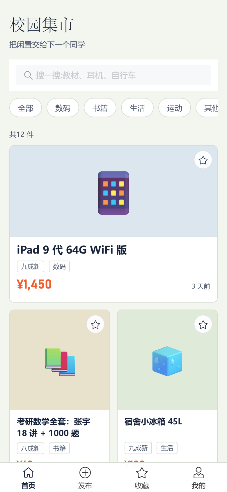
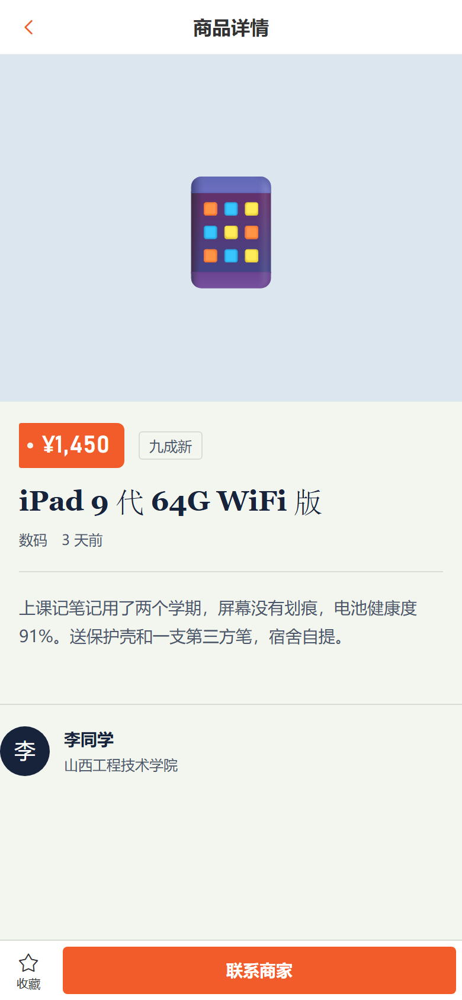
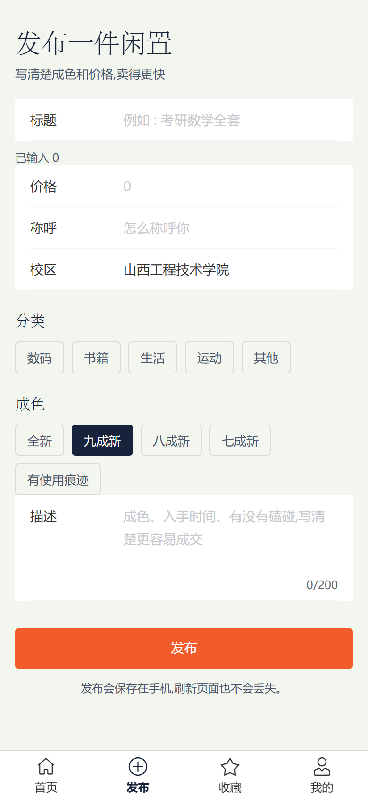

# 校园集市 · Campus Market

一个移动端 H5 校园二手交易项目，用来练习 Vue 3 技术栈，也是求职作品集的第一个完整项目。

完整走一遍真实交易流程：浏览 → 筛选 → 查看详情 → 收藏 → 发布闲置。

**在线体验：** https://agoinn.github.io/campus-market/

<p>
  
  
  
</p>

## 功能

- **首页**：关键词搜索、分类筛选、精选大图卡片、骨架屏、下拉刷新、空结果提示
- **详情**：从路由参数取商品、收藏（多个页面自动同步）、商品不存在时的空状态
- **发布**：表单校验、分类 / 成色选择、发布成功后跳转到详情页
- **收藏**：收藏列表，取消收藏后立即消失
- **我的**：我发布的商品、发布数 / 收藏数统计

## 技术栈

| 技术 | 用途 |
| --- | --- |
| Vue 3.5（`<script setup>` + TypeScript） | 页面与组件 |
| Vite 8 | 开发服务器与构建 |
| Vue Router 5 | 路由与页面懒加载 |
| Pinia 4 | 商品、收藏状态 |
| Vant 4 | 移动端组件库（按需引入） |
| localStorage | 发布与收藏的持久化 |

## 实现细节

- **状态共享**：收藏只存商品 id，完整数据放在 items store 里。详情页、首页卡片、收藏页读的是同一份 Pinia 状态，所以点了收藏不需要手动通知其他页面。
- **本地持久化**：发布和收藏写入 localStorage，刷新页面不丢。
- **按需引入**：Vant 用 `unplugin-vue-components` + `VantResolver` 自动引入模板中用到的组件及样式，JS 从 115KB gzip 降到约 71KB。`showToast` 是函数式调用，插件扫描不到，样式需要单独引入一次。
- **GitHub Pages 部署**：构建时 `base` 为 `/campus-market/`；构建后把 `index.html` 复制成 `404.html`，直接刷新 `/item/xxx` 这类地址不会白屏。

## 本地运行

需要 Node.js 20+。

```bash
npm install
npm run dev      # 本地开发，默认 http://localhost:5173
npm run build    # 类型检查 + 构建到 dist/
npm run preview  # 预览构建产物
npm run typecheck # 只跑类型检查
```

## 目录结构

```
src/
├─ api/            # http 实例 + 商品接口（当前为本地 mock）
├─ components/     # ItemCard 等可复用组件
├─ data/           # 12 件种子商品
├─ router/         # 路由表，页面全部懒加载
├─ stores/         # Pinia：items、favorites
├─ types/          # Item 类型与分类/成色常量
├─ utils/          # 价格、时间、分类映射
├─ views/          # Home / Detail / Publish / Favorites / Profile
├─ App.vue         # 页面壳 + 底部导航
├─ main.ts         # 注册 Pinia / Router / Vant 按需样式
└─ style.css       # 设计变量与全局样式
```

## 数据怎么流动

```
api/items.ts (mock Promise)
        ↓
stores/items.ts (Pinia)
        ↓
HomeView / DetailView / ProfileView
        ↓
localStorage（发布与收藏）
```

- 首页首次进入调用 `itemsStore.load()`，模拟 450ms 网络延迟，所以能看到骨架屏。
- 发布时先写入 Pinia，再 `persist()` 到 localStorage；刷新后“我发布的”会保留在列表最前面。
- 收藏只存商品 id，不复制商品对象，避免两份数据不同步。

### 换成真实后端

1. 复制 `.env.example` 为 `.env.local`，配置 `VITE_API_BASE_URL`。
2. 把 `src/api/items.ts` 里的模拟 Promise 换成：

```ts
import { http } from './http'

export async function fetchItems(): Promise<Item[]> {
  return (await http.get<Item[]>('/items')).data
}
```

3. 发布改为 `http.post('/items', input)`，成功后再写入 store。

## 设计说明

视觉取自校园跳蚤市场的纸质价签和公告栏：宋体标题、Bahnschrift 数字、橘红色价签；底色是偏冷的灰绿纸色。整个页面只保留一个记忆点（价签），其余用细线、留白和方形边角保持安静。

## 面试怎么讲（3 分钟版）

1. **一句话**：一个校园二手交易 H5，解决毕业季闲置处理；我独立完成了从页面、状态到部署的完整流程。
2. **技术选择**：Vue 3 + Vant 适合快速做移动端；Pinia 负责跨页面状态；接口层单独封装，方便从 mock 切到真实后端；页面全部路由懒加载。
3. **一个具体问题**：发布后要立刻能在详情页看到商品。做法是先把商品写进 Pinia，再持久化到 localStorage，详情页只从 store 取数据；收藏则只存 id，避免商品对象出现两份。
4. **一个优化**：Vant 原本全量注册，改成 `unplugin-vue-components` 按需引入后 JS 从 115KB 降到 71KB gzip；同时按路由做了代码分割。
5. **可改进**：图片上传、分页加载、错误重试、单元测试。

不要把它说成“企业级项目”。面试官更想听你做决定的过程、遇到的问题和验证方式。

## 接下来练手（按顺序）

1. **图片上传**：Vant `Uploader` + 本地预览（先不做后端）。
2. **下拉分页**：`van-list` 触底加载，mock 里造 50 条数据。
3. **搜索历史**：localStorage 保存最近 5 条，支持清空。
4. **登录 / 权限**：mock 一个用户，发布和“我的”页需要登录。
5. **错误态与重试**：接口失败时显示可重试的空状态。
6. **单元测试**：用 Vitest 测 `stores` 的 add / toggle。

## 说明

数据是本地 mock：`src/api/items.ts` 用 450ms 延迟模拟接口返回，没有后端。发布的商品和收藏只保存在当前浏览器里，换设备或清缓存就没了。
